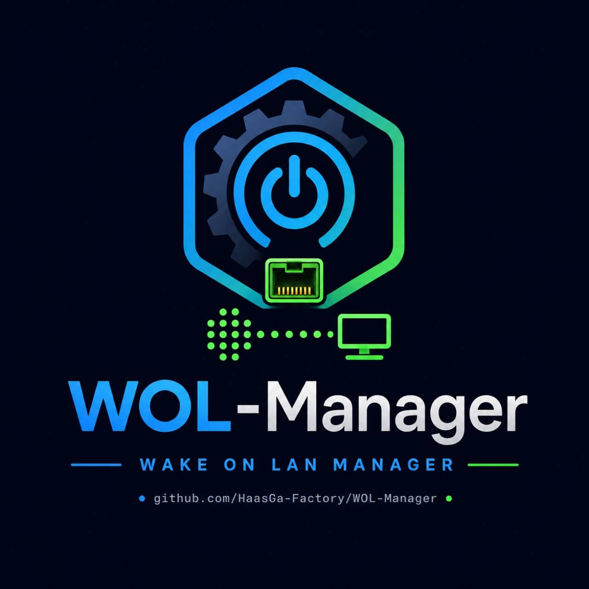
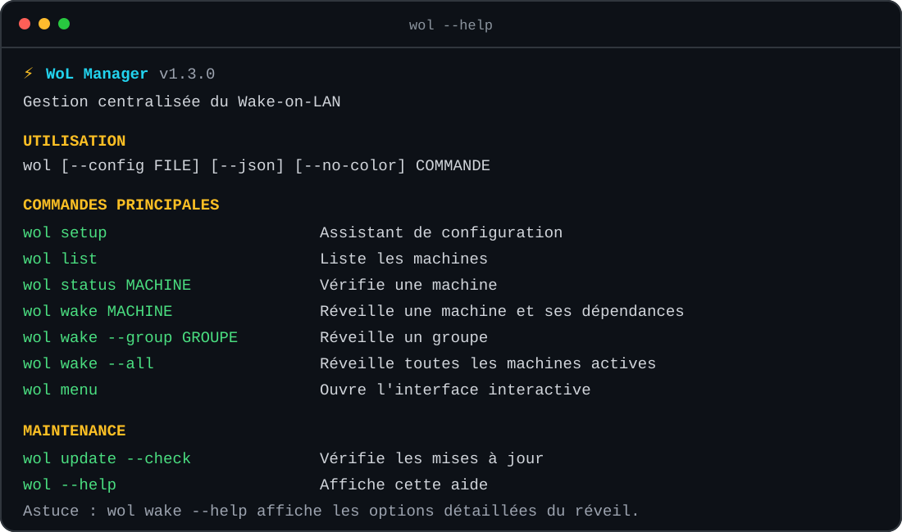

<div align="center">

<a href="https://github.com/HaasGa-Factory/WOL-Manager">
  
</a>

**Gestion centralisée du Wake-on-LAN pour Linux**

Réveillez, vérifiez et orchestrez vos machines sur plusieurs réseaux, avec une
CLI guidée, une API authentifiée et une reprise prudente pilotée par NUT.

[](https://github.com/HaasGa-Factory/WOL-Manager/releases/latest)
[](LICENSE)
[](https://github.com/HaasGa-Factory/WOL-Manager/issues)
[](https://github.com/HaasGa-Factory/WOL-Manager/commits/dev)


[](https://github.com/HaasGa-Factory/WOL-Manager/releases/latest)
[](docs/premiers-pas.md)
[](#documentation)
[](https://ko-fi.com/T8J42AEDRE)

<br>

<a href="docs/cli.md">
  
</a>

<sub>Aperçu de l'aide intégrée — cliquez sur l'image pour consulter la référence CLI.</sub>

</div>

## En bref

| ⚡ Réveil maîtrisé | 🔌 Reprise après coupure | 🔐 Administration sécurisée |
|---|---|---|
| Machines, groupes, dépendances, simulations et vérifications ICMP/TCP/ARP. | Surveillance NUT facultative, seuils batterie et reprise des seules machines nécessaires. | Configuration protégée, jetons API hachés, relais mTLS et mises à jour signées. |

La branche `dev` prépare WoL Manager `v1.3.0`. La release GitHub marquée
**Latest** reste la version stable officielle. WoL Manager est un gestionnaire Wake-on-LAN Linux centralisé pour
plusieurs réseaux, VLAN, groupes, relais et UPS NUT. Il fonctionne sans Docker
et sans accès Internet à l'exécution.

### Navigation rapide

- [Installation stable](#installation-stable)
- [Fonctions](#fonctions)
- [Sauvegardes et restauration](#sauvegardes-et-restauration)
- [Mises à jour et canaux](#mises-à-jour-et-canaux)
- [Essai sans installation](#essai-sans-installation)
- [Documentation](#documentation)
- [Limites connues](#limites-connues)

Dans ce projet, la release GitHub marquée **Latest** est la référence officielle
pour une nouvelle installation stable depuis le canal `main`. La branche
`dev` peut documenter une version plus récente qui n'est pas encore la version
stable proposée par ce lien.

> **Précaution :** testez d'abord les opérations de réveil avec `--dry-run`.
> Un paquet WoL émis ne prouve ni sa réception ni le réveil effectif d'une
> machine.

## Fonctions

- configuration YAML déclarative et strictement validée ;
- broadcast local, broadcast dirigé explicitement autorisé et relais mTLS ;
- dépendances, groupes et reprise NUT séquentielle ou parallèle après un cycle de coupure réellement observé ;
- seuils batterie bas/haut, stabilité secteur, politiques d'échec et reprise prudente après redémarrage ;
- contrôles ICMP/TCP/ARP multiples avec logique ET/OU et quatre états distincts ;
- distinction explicite entre héritage des contrôles et absence de vérification ;
- découverte passive et diagnostic actif avec liste blanche, budget, débit, délai et audit ;
- API `/api/v1` avec jetons hachés, permissions et limitation de débit ;
- sauvegarde et restauration contrôlées de la configuration, des jetons et de l'état persistant ;
- client NUT facultatif ;
- binaire unique, service systemd facultatif.

## Installation stable

**Systèmes ciblés :** Debian 12 et Debian 13, architectures AMD64 et ARM64.

L'installation depuis une release officielle ne nécessite ni Git, ni Go, ni
Docker.

1. Ouvrez la [dernière release stable](https://github.com/HaasGa-Factory/WOL-Manager/releases/latest).
2. Dans **Assets**, téléchargez une seule des deux archives :
   `wol-manager-vX.Y.Z-installer.tar.gz` ou
   `wol-manager-vX.Y.Z-installer.zip`.
3. Extrayez l'archive sur la machine Debian.
4. Ouvrez un terminal dans le répertoire extrait contenant `install.sh`, puis
   lancez :

```sh
chmod +x install.sh
sudo ./install.sh
```

`X.Y.Z` représente la version de la release. Les archives contiennent déjà
l'installateur, les binaires AMD64/ARM64, le manifeste signé et les sommes de
contrôle : aucune compilation n'est effectuée sur la machine cliente.

L'installateur active aussi l'autocomplétion Bash : dans un nouveau terminal, `wol m<Tab>` complète la commande `menu` et `wol config m<Tab>` complète `machine`.

Pour l'activer immédiatement dans un terminal déjà ouvert :

```sh
source /etc/bash_completion.d/wol-manager
# ou, sans écrire de fichier :
source <(wol completion bash)
```

L'installateur sélectionne automatiquement le binaire Linux AMD64/ARM64 signé présent dans `dist/`, contrôle les dépendances et propose le mode systemd. Le manifeste signé couvre aussi la copie de l'installateur système afin que les corrections d'installation suivent les mises à jour futures. Il n'installe, ne télécharge et n'utilise jamais Go. Si aucun artefact compatible et vérifiable n'est disponible, l'installation s'arrête proprement.

L'utilisateur réel ayant lancé `sudo ./install.sh` est ajouté de façon idempotente au groupe
`wol-manager` afin de lire la configuration protégée sans `sudo`. Root n'est jamais ajouté. Ouvrez
ensuite une nouvelle session ou exécutez `newgrp wol-manager`. Les écritures administratives
(`wol setup`, `wol config ...`, jetons et service) continuent à utiliser `sudo`; les fichiers ne sont
jamais rendus lisibles par tous les utilisateurs.

`sudo wol setup` guide ensuite l'ajout des réseaux, machines, groupes, dépendances, découverte réseau et serveurs NUT. Un utilisateur normal n'a pas à modifier le YAML. Saisissez `?` dans n'importe quel champ pour obtenir une explication sans changer la valeur. Chaque enregistrement est validé, contrôlé pour son aptitude opérationnelle, sauvegardé et écrit atomiquement ; une simulation WoL automatique ne transmet aucun Magic Packet.

Toutes les commandes disposent d'une aide sans charger la configuration, par exemple
`wol wake --help`, `wol config group --help` ou `wol automation status --help`. Dans les menus
interactifs, saisissez `?` pour afficher l'aide du contexte courant. L'aide colorée se désactive
automatiquement dans les pipes et redirections ; utilisez `wol --no-color --help` ou `NO_COLOR=1`
pour la désactiver explicitement.

Si vous activez immédiatement le service lors d'une première installation interactive, l'installateur crée et affiche le premier jeton administrateur. En mode CLI ou si vous configurez l'API plus tard :

```sh
sudo wol token create --id admin --permissions read,wake,admin
sudo wol token list
sudo wol token revoke --id admin
```

Le jeton s'utilise comme en-tête Bearer, par exemple :

```sh
TOKEN='<jeton-affiché-une-fois>'
curl -H "Authorization: Bearer $TOKEN" http://127.0.0.1:8080/api/v1/health
```

La création et la révocation sont prises en compte par l'API dès la requête suivante, sans redémarrer
le service. `token list` n'affiche jamais les secrets ni leurs hashes.

## Sauvegardes et restauration

La sauvegarde la plus sûre et la plus simple reste le niveau par défaut : la
configuration validée uniquement.

```sh
sudo wol backup create
sudo wol backup list
sudo wol backup inspect /var/backups/wol-manager/wol-manager-backup-....wolbackup
sudo wol backup verify /var/backups/wol-manager/wol-manager-backup-....wolbackup
```

Pour préparer une restauration, commencez toujours par une simulation :

```sh
sudo wol backup restore SAUVEGARDE.wolbackup --dry-run
sudo wol backup restore SAUVEGARDE.wolbackup
```

`--with-tokens` ajoute le magasin de jetons API. `--full` ajoute aussi l'état
des jobs et cycles. Une restauration ne remet que la configuration par défaut ;
les autres sections exigent `--sections`. La restauration de l'état exige que
`wol-manager.service` soit arrêté et place les jobs actifs en
`revalidation_required`.

Les archives sont stockées par défaut sous `/var/backups/wol-manager`, en mode
`0600`, hors du répertoire détenu par le service. Elles ne sont ni chiffrées ni
signées : leurs SHA-256 détectent une corruption, mais ne prouvent pas leur
origine. Conservez-les sur un support protégé. Consultez le
[guide sauvegarde et restauration](docs/backups.md) avant un transfert ou une
restauration complète.

## Mises à jour et canaux

```sh
wol update --check
sudo wol update
wol update --check --channel dev
sudo wol update --channel dev
wol version
wol ups test
wol automation status
```

Le canal `dev` est temporaire et n'est jamais mémorisé comme canal par défaut.

Si une version `dev` utilisant le manifeste de format 2 est installée alors que `main` publie encore le format signé 1, `wol update --check` explique cette transition et ne modifie rien. Utilisez `wol update --check --channel dev` jusqu'à la publication de cette version sur `main` ; aucun retour automatique vers une ancienne version n'est tenté.

L'installateur système `1.2.3` sait migrer une ancienne configuration utilisant `unicast` : retrait
des anciens champs, contrôle qu'un broadcast ou un relais utilisable reste configuré, résumé,
confirmation et sauvegarde datée. Une installation encore équipée de l'installateur `1.2.1` doit
d'abord remplacer uniquement `/usr/local/lib/wol-manager/install.sh` par le fichier signé
`dist/install.sh` du paquet `1.2.3`, selon la [procédure d'amorçage vérifiée](docs/updates.md#amorçage-depuis-linstallateur-121).

Le canal `main` correspond aux versions stables. Le canal `dev` sert aux tests
et validations. Une nouvelle installation stable doit privilégier la
[GitHub Release marquée Latest](https://github.com/HaasGa-Factory/WOL-Manager/releases/latest).

## Essai sans installation

Pour un essai depuis une copie du dépôt contenant les artefacts de
distribution :

```sh
cp configs/wol.example.yaml wol.yaml
./dist/wol-linux-amd64 --config ./wol.yaml config check
./dist/wol-linux-amd64 --config ./wol.yaml --json network discover
./dist/wol-linux-amd64 --config ./wol.yaml --json wake storage-1 --dry-run
```

Sur ARM64, remplacez `wol-linux-amd64` par `wol-linux-arm64`.

## Documentation

Pour débuter :

- [Premiers pas](docs/premiers-pas.md) : installation, première machine et simulation ;
- [Installation et désinstallation](docs/installation.md) ;
- [Configuration guidée](docs/configuration.md) ;
- [Diagnostics](docs/diagnostics.md).

Pour administrer des fonctions avancées :

- [Référence CLI](docs/cli.md) ;
- [Mises à jour et rollback](docs/updates.md) ;
- [Sauvegarde et restauration](docs/backups.md) ;
- [API REST](docs/api.md) et [contrat OpenAPI](api/openapi.yaml) ;
- [Réseaux, VLAN et relais](docs/multi-vlan.md) ;
- [Broadcast WoL et migration de l'ancien unicast](docs/wol-broadcast-and-migration.md) ;
- [NUT et reprise après coupure](docs/nut.md) ;
- [Sécurité](docs/security.md).

Pour contribuer : [architecture](docs/architecture.md) et
[compilation/publication locale](docs/development.md).

## Limites connues

- Linux avec `iproute2` est requis pour les routes et voisins détaillés.
- L'installateur cible Debian 12 et 13 sur AMD64/ARM64. Ses scénarios sont testés avec un système simulé ; la validation finale sur quatre VM réelles reste obligatoire avant d'annoncer officiellement la compatibilité.
- Les binaires de distribution sont compilés localement et versionnés dans Git ; GitHub Actions ne compile ni ne publie le logiciel.
- Le stockage JSON atomique vise un service unique ; il ne convient pas à plusieurs instances partageant les mêmes fichiers.
- La reprise automatique exige un cycle NUT observé, une batterie connue lorsque des seuils sont configurés et un service WoL Manager actif pendant la surveillance ; ce n'est pas un planificateur généraliste.
- Une validation matérielle NUT et une exécution ARM64 réelles restent nécessaires avant de qualifier ces chemins pour la production.
- Le diagnostic ne peut confirmer la réception que si un relais ou une vérification de disponibilité l'observe.
- Le mode relais conserve ses identifiants anti-rejeu en mémoire pendant 24 heures ; après redémarrage, une revalidation reste nécessaire côté orchestrateur.
- Le client NUT implémente les variables standard nécessaires à la politique, pas toute la console `upscli`.

## Licence

WoL Manager est distribué dans son intégralité sous la GNU Affero General
Public License version 3 uniquement (`AGPL-3.0-only`). Toute redistribution,
originale ou modifiée, est soumise à cette licence. Lorsqu'une version modifiée
permet une interaction à distance par un réseau, elle doit offrir gratuitement
à ces utilisateurs l'accès à son code source correspondant, conformément à
l'article 13 de l'AGPL v3.
