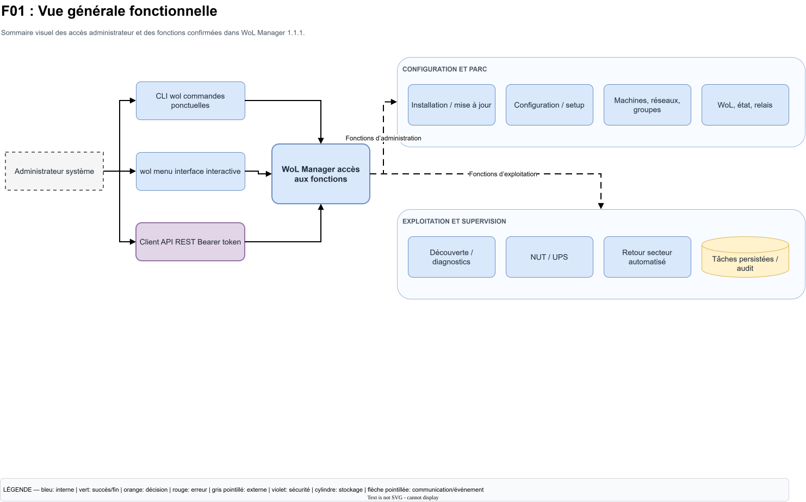
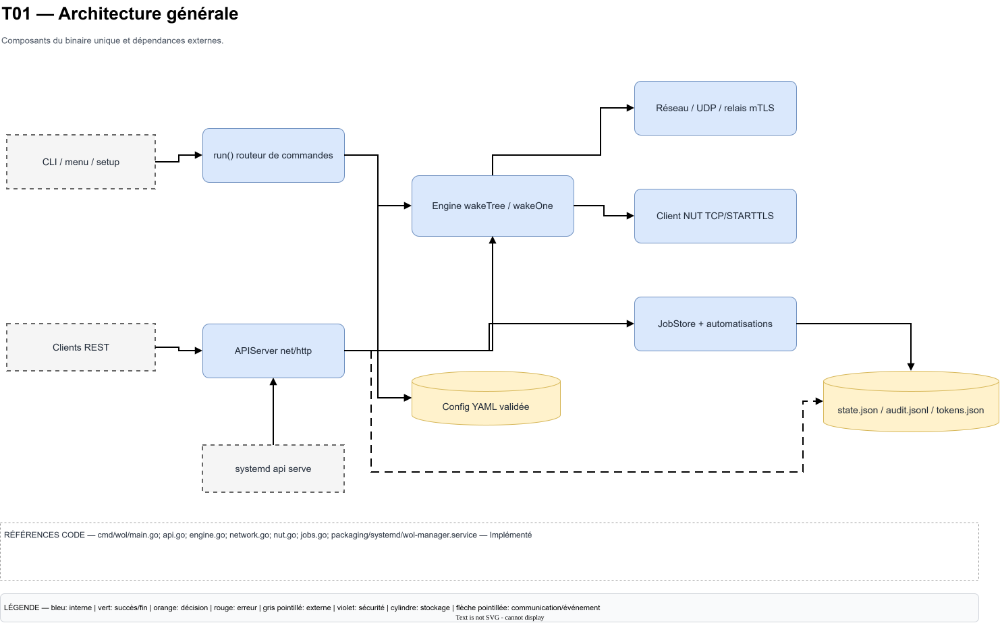

# Cartographie WoL Manager

Ce dossier contient deux diagrammes diagrams.net entièrement modifiables, construits à partir de l'implémentation présente dans le dépôt :

- `WoL-Manager-Fonctionnel.drawio` : parcours administrateur, décisions, résultats et erreurs ;
- `WoL-Manager-Technique.drawio` : composants, appels, protocoles, données, persistance, sécurité, installation et distribution.

Les fichiers utilisent le XML natif draw.io non compressé. Les formes, textes et connecteurs restent éditables individuellement ; aucune page n'est une image aplatie.

## Aperçus

Les images ci-dessous affichent la première page de chaque cartographie sur GitHub. Cliquer sur un aperçu ouvre le fichier `.drawio` multipage correspondant, qui reste la source modifiable.

### Cartographie fonctionnelle

### Cartographie technique

## Référence analysée

- Branche locale auditée : `dev`.
- Commit source de départ : `27df0c8` ; les changements V1.2.0 décrits ici sont encore dans l'arbre de travail et n'ont pas été commités.
- Version du programme préparée : `1.2.0`, définie dans `cmd/wol/main.go` et `install.sh`.
- Distribution : `dist/` n'a volontairement pas été reconstruit ; ses artefacts ne représentent pas encore la V1.2.0.
- Date de l'analyse : 18 octobre 2026.

La branche n'a pas été changée. Aucune commande Git d'écriture n'a été exécutée.

## Pages du diagramme fonctionnel

| Page | Objectif |
| --- | --- |
| F01 — Vue générale | Sommaire visuel des points d'accès et grandes fonctions. |
| F02 — Installation initiale | Installation Debian depuis artefacts signés, modes systemd et erreurs. |
| F03 — Configuration initiale | Parcours complet de `wol setup`, validation, confirmation et sauvegarde. |
| F04 — Gestion des machines | Lecture, modification guidée, état, simulation et réveil réel. |
| F05 — Réseaux et groupes | CIDR, interfaces, associations, membres, dépendances et refus de suppression. |
| F06 — Wake-on-LAN | Dépendances, politique UPS, transports, Magic Packet et vérification. |
| F07 — Découverte et relais | Découverte passive/active, garde-fous et relais mTLS. |
| F08 — NUT et UPS | Détection, connexion, lecture NUT, états et erreurs. |
| F09 — Orchestration électrique | Portée réelle de l'automatisation au retour du secteur. |
| F10 — Automatisations et tâches | Déclencheurs implémentés, états des tâches et reprise après redémarrage. |
| F11 — Utilisation de l'API | Authentification, autorisation, action, tâche et réponse HTTP. |
| F12 — Mises à jour | Canaux `main`/`dev`, vérifications, remplacement et rollback. |
| F13 — Erreurs et diagnostics | Scénarios d'erreur et sources de diagnostic réellement disponibles. |

## Pages du diagramme technique

| Page | Objectif |
| --- | --- |
| T01 — Architecture générale | Vue des composants du binaire unique et dépendances externes. |
| T02 — Packages Go | Architecture réelle : un unique `package main`, séparé par fichiers. |
| T03 — Initialisation et cycle de vie | Routage CLI, chargement, commandes ponctuelles et service permanent. |
| T04 — CLI, menu et API | Composants métier partagés et différence synchrone/asynchrone. |
| T05 — Moteur WoL | `wakeTree`, `wakeOne`, Magic Packet, UDP/relais, retries et checks. |
| T06 — Réseau et relais | Flux IPv4, broadcasts, VLAN externes et relais HTTPS mTLS. |
| T07 — API REST | Routes, middleware, Bearer tokens, permissions, limites et erreurs. |
| T08 — Client NUT | TCP, STARTTLS, protocole texte, variables, états et limites. |
| T09 — Orchestrateur | Détection du retour secteur stable et déclenchement du groupe. |
| T10 — Automatisations et planificateur | Modèle `Automation`, `JobStore` et fonctions absentes. |
| T11 — Configuration YAML | Parsing strict, validation, héritage, sauvegarde et permissions. |
| T12 — Stockage et sécurité | Fichiers persistants, identités, modes, secrets et protections. |
| T13 — systemd | Installation de l'unit, identité, durcissement, démarrage et journaux. |
| T14 — Compilation et distribution | Tests, builds AMD64/ARM64, manifeste, SHA-256 et signature. |
| T15 — Installation Debian | Chaîne technique de `install.sh` sans compilation client. |
| T16 — Mise à jour et rollback | Résolution du canal, vérifications, sauvegarde et restauration. |
| T17 — Matrice des composants | Responsabilités, entrées, protocoles, données et pages associées. |
| T18 — Fonctions partielles ou prévues | Limites observées, absences et validations externes restantes. |

## Convention graphique

- Rectangle arrondi bleu : action ou composant interne.
- Losange orange : décision ou condition.
- Ellipse verte : début, fin ou résultat validé.
- Cylindre jaune : fichier ou stockage persistant.
- Rectangle gris pointillé : acteur, système ou infrastructure externe.
- Rectangle violet : authentification, autorisation ou garde-fou de sécurité.
- Rectangle rouge : erreur, refus, fonction absente ou limite importante.
- Flèche pleine : flux d'exécution.
- Flèche pointillée : communication, événement, dépendance ou limite documentée.

Chaque page répète une légende. Chaque page technique contient en outre une zone « Références code » avec les fichiers, fonctions ou types structurants et l'état d'implémentation.

## Méthode d'analyse

L'analyse a suivi cet ordre de preuve : code Go, tests, scripts/configurations, documentation, puis attentes fonctionnelles. Les éléments examinés incluent notamment :

- `cmd/wol/*.go` et les tests `*_test.go` ;
- `install.sh`, `scripts/build.sh`, `tests/install_test.sh` ;
- `packaging/systemd/wol-manager.service` ;
- `configs/wol.example.yaml`, `api/openapi.yaml` ;
- `dist/manifest.json`, `dist/SHA256SUMS` et les artefacts AMD64/ARM64 ;
- `README.md`, `CHANGELOG.md`, `SECURITY.md` et `docs/*.md`.

Le code a priorité en cas d'écart. Les flux principaux des diagrammes ne présentent comme opérationnelles que les fonctions confirmées dans l'implémentation.

## Références principales au code

- Entrée, CLI, menu et tokens : `cmd/wol/main.go`.
- Configuration et héritage : `cmd/wol/config.go`.
- Assistant et écriture atomique : `cmd/wol/setup.go`, `cmd/wol/config_file_linux.go`.
- WoL, dépendances et relais client : `cmd/wol/engine.go`.
- Transports, découverte et paquet magique : `cmd/wol/network.go`, `cmd/wol/udp_linux.go`.
- Vérification d'état : `cmd/wol/check.go`.
- API, relais serveur et automatisations : `cmd/wol/api.go`.
- NUT : `cmd/wol/nut.go`.
- Tâches persistées : `cmd/wol/jobs.go`.
- Audit : `cmd/wol/audit.go`.
- Mise à jour CLI : `cmd/wol/update.go`.
- Installation, rollback et publication : `install.sh`, `scripts/build.sh`.

## Classification et écarts observés

### Implémenté

- CLI, menu, assistant guidé et édition avancée par éditeur local.
- Réseaux IPv4, machines, groupes, dépendances et validation des cycles/références.
- Magic Packet UDP par broadcast local, unicast, broadcast dirigé autorisé ou relais.
- Relais HTTPS avec authentification mutuelle TLS.
- Vérifications TCP, ICMP et ARP, avec la réserve explicite qu'ARP ne prouve pas l'allumage.
- Découverte passive et diagnostic actif protégé par activation, sous-réseaux, confirmation, budget, débit et timeout.
- API REST avec Bearer token, SHA-256, comparaison constante, permissions et limitation de débit.
- Client NUT en lecture seule, TCP/STARTTLS, sélection d'UPS et politiques avant réveil.
- Tâches persistées, annulation et revalidation après redémarrage.
- Installation Debian binaire, manifeste Ed25519, SHA-256, mise à jour atomique et rollback.

### Partiel

- L'orchestration électrique V1.2 persiste les cycles observés, applique les seuils et la stabilité par groupe, puis réveille en mode séquentiel ou parallèle.
- Les automatisations restent limitées au retour secteur NUT ; il n'existe pas de planificateur cron/calendrier générique.
- Une automatisation interrompue exige une revalidation NUT complète après redémarrage ; la découverte active n'est jamais reprise.
- Les tentatives de réveil sont bornées par politique ; il n'existe pas d'historique séparé de `state.json`.
- Le service HTTP n'installe pas de gestionnaire explicite de signaux ni d'appel à `http.Server.Shutdown`.
- Le champ YAML `enabled` d'une machine est appliqué par le moteur, mais l'assistant machine ne propose pas de bascule dédiée.

### Non implémenté ou uniquement attendu

- Arrêt contrôlé des machines lors d'un passage sur batterie ou d'une batterie faible.
- Envoi de commandes NUT de contrôle ou d'extinction.
- Contrôle du BIOS, de l'UPS ou d'équipements électriques externes.
- CRUD des machines/réseaux/groupes par l'API REST.
- Rechargement dynamique de la configuration sans redémarrer le processus.
- GitHub Actions ou GitHub Releases obligatoires pour compiler/publier : le dépôt décrit un build local.

### Non vérifié dans cette mission

- Exécution réelle du binaire ARM64 et matrice complète sur de vraies VM Debian 12/13.
- Réseau, relais, NUT, UPS, systemd ou réveil réels : aucun contact ni aucune action sur l'infrastructure n'a été effectué.
- Export automatique des aperçus SVG : la commande draw.io locale a échoué sans modifier les aperçus existants ; les sources `.drawio` restent la référence V1.2.0.

## Contrôles des fichiers draw.io

Une validation locale a confirmé :

- XML bien formé et racine `mxfile` native non compressée ;
- 13 pages fonctionnelles et 18 pages techniques ;
- 31 identifiants de page uniques ;
- structure XML native éditable conservée après les ajouts V1.2.0 ;
- aucune clé privée, aucun jeton réel et aucun mot de passe dans les diagrammes.

La tentative d'export des aperçus avec l'application draw.io locale a échoué. Par conséquent, aucune validation visuelle complète de la version V1.2.0 dans l'application n'est revendiquée et les aperçus SVG existants n'ont pas été remplacés. Une revue visuelle humaine des deux sources reste recommandée avant publication.

## Ouvrir les fichiers hors ligne

1. Ouvrir l'application desktop diagrams.net, ou `app.diagrams.net` dans un navigateur.
2. Choisir **Fichier → Ouvrir depuis → Périphérique**.
3. Sélectionner l'un des fichiers `.drawio` de ce dossier.
4. Utiliser les onglets de pages en bas de l'éditeur.
5. Pour conserver le XML local, enregistrer au format **Fichier de périphérique** sans conversion en image.

Les fichiers ne dépendent d'aucune image externe et peuvent être ouverts hors ligne avec l'application desktop diagrams.net.

## Actualiser les diagrammes après une évolution

1. Relever la branche, le commit, la version et le manifeste réellement présents.
2. Examiner d'abord le diff du code Go, puis les tests, scripts, configurations et documentation associés.
3. Rejouer les chemins d'appel concernés depuis `run()` ou les handlers API jusqu'au stockage ou au réseau.
4. Mettre à jour le diagramme fonctionnel si le parcours administrateur ou les décisions changent.
5. Mettre à jour le diagramme technique et sa zone de références si les composants, fonctions, protocoles ou fichiers changent.
6. Reclasser explicitement les fonctions implémentées, partielles, absentes ou non vérifiées.
7. Contrôler les identifiants, connecteurs, chevauchements, limites de page et présence des légendes.
8. Ouvrir toutes les pages dans diagrams.net et vérifier visuellement textes, flèches, croisements et impression.
9. Mettre à jour dans ce README la branche, le commit, la version, les limites et les résultats de validation.

