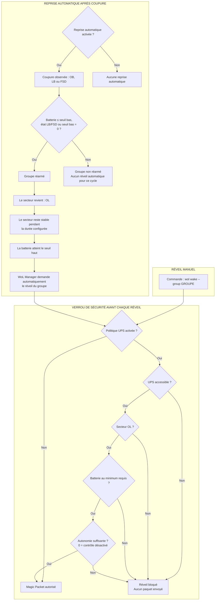

# Intégration NUT

NUT est facultatif. Sans `ups` ni politique UPS, WoL Manager n'ouvre aucune connexion NUT.

Dans `sudo wol setup`, choisissez la section NUT, ou ouvrez-la directement avec `sudo wol config nut`. L'assistant propose de tester `127.0.0.1:3493`, exécute `LIST UPS`, permet une sélection multiple et exige une lecture valide de `ups.status` avant enregistrement. Un serveur distant peut être ajouté même si le serveur local fonctionne. L'assistant ne scanne jamais le réseau, n'installe pas NUT, ne modifie pas sa configuration et ne redémarre aucun service NUT.

Utilisez `wol config nut --help` avant l'assistant ou saisissez `?` dans son menu pour afficher ces
limites de sécurité. L'assistant couvre la détection, l'adresse, le port, STARTTLS et la sélection
des UPS. Les références avancées `ca_cert`, `username_file` et `password_file` restent configurables
dans le YAML puis contrôlables avec `wol config check`; les secrets eux-mêmes ne doivent jamais être
placés directement dans le YAML.

```sh
wol ups test
```

Ce diagnostic relit uniquement les UPS configurés. Il distingue notamment timeout, port fermé, service non-NUT, accès refusé, UPS inconnu et absence de `ups.status`. Les métriques de batterie restent facultatives pour le diagnostic, mais `battery.charge` doit être connue pour autoriser une reprise utilisant des seuils.

Les états reconnus sont `OL`, `OB`, `LB`, `FSD` et `unknown`, ainsi que `battery.charge` et `battery.runtime`. Une politique applicable bloque le réveil si l'état est inconnu ou la communication impossible.

Pour un serveur NUT distant, activer `tls: true` : le client négocie `STARTTLS`, vérifie le nom du serveur et accepte une CA privée via `ca_cert`. Une connexion distante en clair est refusée sauf `allow_insecure_remote: true`, réservé à un tunnel ou réseau administratif déjà protégé. Les identifiants sont lus depuis des fichiers privés.

## Protection UPS et reprise automatique

Ces deux fonctions sont complémentaires, mais différentes :

- `ups_policy` est un verrou de sécurité vérifié avant chaque réveil, manuel ou automatique ;
- `power_restore` décide si WoL Manager doit déclencher lui-même le réveil d'un groupe après une coupure réellement observée.



Exemple : avec une politique UPS exigeant 70 % de batterie et une reprise automatique configurée avec un seuil bas de 40 % et un seuil haut de 70 %, la coupure réarme le cycle uniquement si la batterie atteint 40 % ou moins, ou si NUT signale `LB` ou `FSD`. Une coupure plus courte qui se termine au-dessus de 40 % ne provoque aucun réveil automatique. Configurer le seuil bas à 0 % réarme dès toute coupure observée. Après le retour du secteur stable, atteindre 70 % déclenche la demande de reprise. La politique UPS contrôle alors une dernière fois les 70 % et l'état `OL` avant d'autoriser le Magic Packet.

## Reprise automatique V1.2

Une reprise est possible uniquement après un cycle `OB`, `LB` ou `FSD` réellement observé et enregistré. L'état `OL` initial au lancement ne crée jamais de cycle. Le seuil bas réarme le groupe ; le seuil haut et la durée `stable_for` l'autorisent ensuite. `OB`, `LB`, `FSD`, une erreur NUT, un état inconnu ou une batterie requise mais absente interdisent tout nouveau réveil automatique.

Les cycles et groupes terminés sont persistés avec les tâches. Après un redémarrage, WoL Manager remet toute séquence inachevée en attente, oublie l'ancienne durée de stabilité et revalide NUT avant de reprendre. Un cycle en échec reste terminal et n'est réarmé que par une nouvelle coupure réellement observée. Une nouvelle coupure annule les attentes et empêche les nouveaux Magic Packets. WoL Manager n'envoie jamais de commande NUT d'arrêt, `FSD` ou de contrôle électrique.

Chaque groupe choisit un mode `sequential` ou `parallel`, un ordre, une politique d'échec et des tentatives bornées. Les dépendances restent obligatoires et un coordinateur évite les réveils simultanés en double. Consultez l'état sans modification avec :

```sh
wol automation status
```

La surveillance n'est active que dans le processus permanent `wol api serve`, normalement géré par
systemd. La commande `wol automation status` ne lance pas la surveillance : elle affiche les cycles,
politiques, jobs, progressions et raisons d'attente déjà persistés.

Dans le mode `sequential`, chaque machine doit être validée avant de libérer ses dépendants. Dans le
mode `parallel`, seules les machines indépendantes peuvent progresser en parallèle. Une dépendance
obligatoire n'est jamais contournée. Les politiques d'échec sont :

- `stop` : arrêter la séquence ;
- `continue` : continuer uniquement avec les machines indépendantes ;
- `retry` : retenter de manière bornée avant de poursuivre ;
- `continue_retry` : continuer les éléments indépendants et retenter en parallèle.
